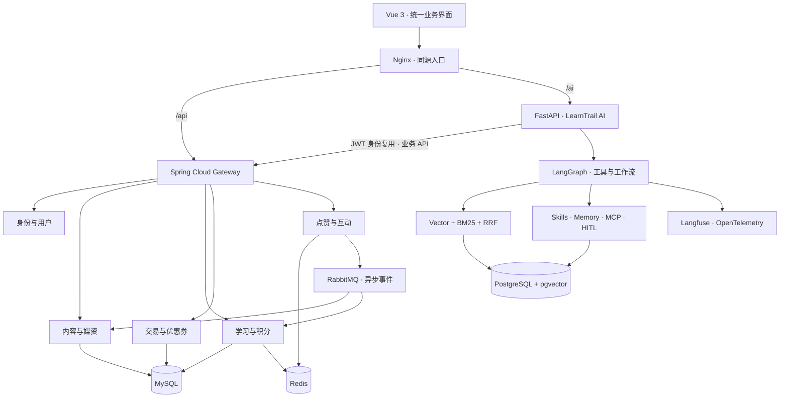

# LearnTrail · 学途

**把内容创作、知识学习与 AI 助手连接起来的创作者知识平台。**

LearnTrail 基于微服务架构持续开发，以文章与视频专栏为内容载体，通过积分交易、学习记录与互动沉淀学习过程。平台中的 AI 助手共享业务身份，能够检索知识、查询学习进度、调用工具，并通过持久化工作流完成多轮任务与人工确认。


## 两个技术方向，一个完整系统

| 模块 | 解决的问题 | 阅读入口 |
| --- | --- | --- |
| **LearnTrail Backend** | 身份认证、内容发布、积分交易、学习进度、互动计数与服务协作 | [Java 后端架构](docs/backend-architecture.md) |
| **LearnTrail AI** | 混合检索、工具调用、工作流恢复、Skills、Memory、MCP 与 HITL | [Agent 专属介绍](learntrail-agent/README.md) |
| **LearnTrail Web** | 统一登录、文章与视频、创作台、个人中心和 AI 助手 | [Vue 3 源码](frontend/learntrail-web/) |

## 整体架构



Java 负责业务事实与资源权限，Python 通过业务 API 获取内容和学习数据，Vue 统一呈现两套服务。代码、接口契约、数据库迁移与测试在同一仓库维护。

## 平台能力

| 场景 | 实现 |
| --- | --- |
| 内容发现 | 文章列表、视频网格、创作者榜单、搜索分页、点赞与浏览／播放量排序 |
| 创作者工作台 | Markdown 文章、视频上传与分集编排、试看、专栏发布与修订、上下架 |
| 积分交易 | 独立钱包、有效学习奖励、积分订单、单张积分券、权益发放与完整流水 |
| 连续学习 | 视频播放授权、试看校验、进度续播、课表、收藏与讨论 |
| 内容互动 | 文章／专栏点赞与取消、公开计数、版本化异步聚合、浏览／播放去重 |
| AI 学习助手 | 知识问答、文章搜索、学习进度查询、工具轨迹、流式输出、暂停与恢复 |
| 可观测与评测 | 请求／模型／工具 Trace、Token 与耗时、检索对照实验、答案与功能契约评测 |

## 界面预览

开发环境真实界面：内容发现、创作者榜单与文章阅读。

<details>
<summary>内容发现与创作者</summary>


</details>

<details>
<summary>文章阅读与点赞</summary>


</details>

## 工程亮点

- **积分交易一致性**：钱包行锁与唯一业务事件控制并发、幂等；扣分、流水、结算凭证和学习权益在同一事务提交，跨服务订单与优惠券通过状态机和恢复任务协调。
- **可靠的互动聚合**：Redis Lua 原子维护点赞关系与统计版本，RabbitMQ 分发快照，MySQL 条件更新防止乱序覆盖，写库完成后按版本确认。
- **可恢复的 Agent**：Function Calling 对接工具 Registry／Executor，LangGraph 编排 Skills、Memory、模型、审批门和工具节点，PostgreSQL 保存加密 Checkpoint。
- **共享业务权限的 RAG**：发布文章增量索引，向量／BM25 双路召回与 RRF 融合，检索及回答阶段复核 Java 内容权限与来源快照。
- **用实验选择方案**：150 条评测场景覆盖 RAG、Agent、Memory、Skills、MCP 与 HITL，记录检索质量、回答状态、工具执行、耗时和 Usage。

## 检索实验

在 v4 评测集的 64 条有相关来源问题上，以 Chunk 为检索单位、K=5，使用同一套 Java 授权文章、1024 维 Embedding 和生产 Retriever：

| 方案 | Recall@5 | MRR@5 | NDCG@5 |
| --- | ---: | ---: | ---: |
| Vector | 0.9922 | 0.9120 | 0.9228 |
| BM25 | 0.9766 | 0.9060 | 0.9147 |
| Hybrid · RRF | **0.9922** | **0.9458** | **0.9466** |

Hybrid 在保持召回的同时提升了靠前结果的排序质量。完整 65 题真实 Hybrid 问答基线中，检索与回答组合条件通过 61 题；零相关题单列检查。实验设置与指标口径见 [Agent 评测](learntrail-agent/README.md#评测与实验)。

## 代码导航

```text
LearnTrail/
├── README.md                    平台总览
├── docs/
│   ├── backend-architecture.md  Java 后端架构与源码入口
│   ├── agent-architecture.md    Agent 工作流与数据流
│   └── quickstart.md            环境、配置与启动
├── tj-gateway/ tj-auth/ ...      Java 微服务
├── frontend/learntrail-web/      Vue 3 统一前端
├── learntrail-agent/
│   ├── README.md                AI 专属介绍
│   ├── src/ tests/              运行代码与测试
│   ├── migrations/              PostgreSQL 迁移
│   ├── evaluation/              评测数据与契约
│   └── pyproject.toml uv.lock   Python 依赖与锁定
├── database/                    Java 业务增量迁移
└── scripts/                     启动、检查与发布工具
```

## 运行与开发

Java 11、Maven、Node.js 24、Python 3.12／uv；业务依赖 MySQL、Redis、RabbitMQ、Nacos，AI 使用 PostgreSQL／pgvector。

```bash
# Java：显式使用 JDK 11
mvn -DskipTests package
python3 scripts/run_local.py

# AI：在另一个终端配置并启动
cd learntrail-agent
uv sync --locked
uv run --locked uvicorn learntrail_agent.deployment:app --host 0.0.0.0 --port 8100 --no-access-log

# Web：在另一个终端，从仓库根目录进入
cd frontend/learntrail-web
npm ci
npm run dev
```

前端开发入口为 `http://localhost:5173`；默认部署域名为 `www.learntrail.com`，通过同源 `/api`、`/ai` 访问服务。配置模板、基础设施准备、增量迁移顺序和 Nginx 示例见 [快速开始](docs/quickstart.md)。

## 持续演进

平台已打通内容、积分交易、学习记录和 AI 助手。后续围绕检索精排、无答案判断、业务工具扩展、自动化交付与运行监控继续演进。

[参与开发](CONTRIBUTING.md) · [工程来源与第三方说明](NOTICE.md)
