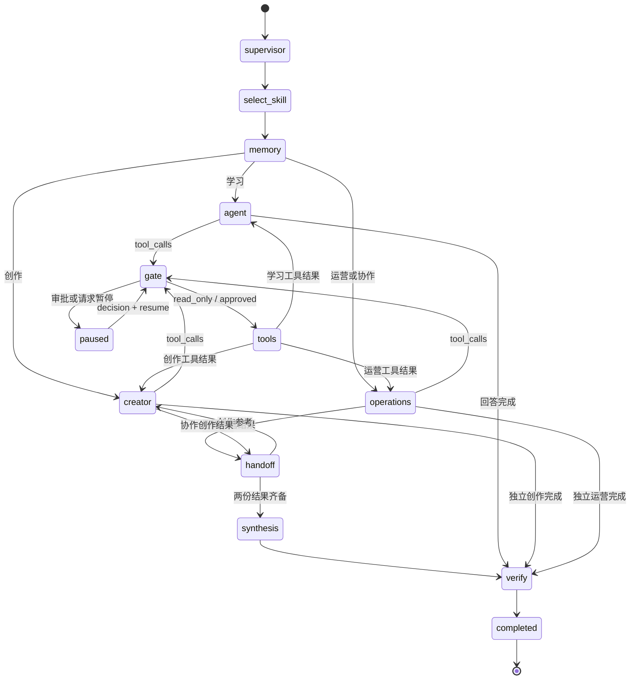
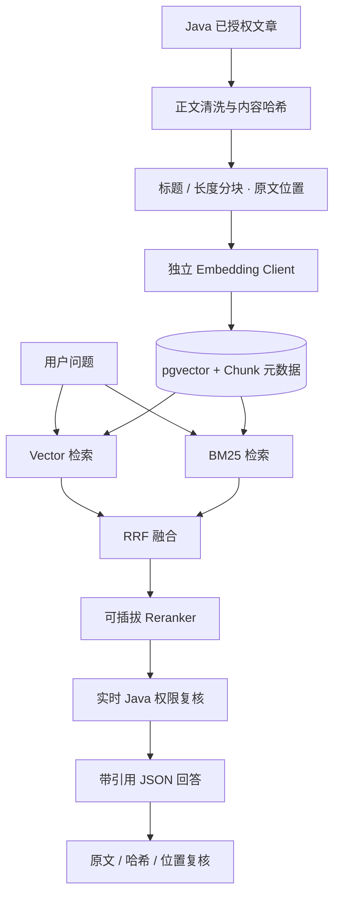

# LearnTrail AI 架构

[Agent 专属介绍](../learntrail-agent/README.md) · [平台总览](../README.md)

## 分层与数据归属

| 层次 | 位置 | 职责 |
| --- | --- | --- |
| 部署入口 | `deployment.py` | 对外 API 白名单、生命周期透传 |
| HTTP API | `api_sessions.py`、`api_agent.py`、`api_capabilities.py` | 请求模型、JWT 身份、SSE 与响应协议 |
| 服务 | `services/` | 会话、任务、来源复核、取消与恢复 |
| Agent | `agent/` | 助手分派、StateGraph、工具注册与执行、Skills |
| RAG | `rag/` | 清洗、分块、增量索引、召回、融合与引用问答 |
| 外部客户端 | `clients/` | 模型、Embedding、Reranker、Java 与 MCP |
| 数据访问 | `storage/` | 会话、索引、Checkpoint、审批、记忆 |
| 评测 | `evaluation/` | 数据契约、执行、指标、Judge 与实验报告 |

上述路径均位于 [learntrail-agent/src/learntrail_agent](../learntrail-agent/src/learntrail_agent/)。Java 管理业务事实，AI PostgreSQL 管理 AI 状态。身份由已验签令牌和 Java 账号状态确定，不从工具参数接收用户身份。

## 工作流与持久化

`supervisor` 依照请求模式或意图关键词分派。学习助手实际执行技能和记忆节点。独立的创作与运营任务跳过这两项准备，使用公开文章工具。协作在同一个 Run 内先运营、再创作，汇总节点根据两份结果回答，整个流程共用模型轮数、工具次数和总时限。

`WorkflowState` 保存助手分派、阶段结果、消息、工具调用和执行状态。服务端创建 Checkpoint thread 标识并关联会话，图状态加密后写入 PostgreSQL。恢复时读取原状态，核验会话归属和已保存来源，并按任务类型复核运营权限或审批状态。

图节点、工具事件和文本增量通过 SSE 发送。协作时输出过程状态和最终汇总的文本增量。单条流队列上限为 256 个事件，满时等待下游腾出空间。持久化完整结果后发送 `done`，取消与断连进入统一清理逻辑。

源码入口见 [分派规则](../learntrail-agent/src/learntrail_agent/agent/assistants.py)、[状态图](../learntrail-agent/src/learntrail_agent/agent/loop.py) 和 [运行服务](../learntrail-agent/src/learntrail_agent/services/agent.py)。

## RAG 数据流

索引指纹绑定正文与 Embedding／Chunk 配置。内容更新切换 generation，重复内容跳过；归档、屏蔽及当前权限变化会影响可返回的证据。引用记录标题、Chunk、Unicode字符位置和内容哈希，连接到站内阅读页及原始来源。

站内文章查找与 RAG 引用检索分别由 `search_articles` 和 `search_knowledge_base` 提供。文章查找在默认排序且标题摘要无匹配时通过 Java 的 Elasticsearch 接口补查全文。全文结果仍需复核文章状态和正文权限。只有当前公开目录确认存在且正文读取明确被拒绝，才返回当前页的受限数量。

## 工具、Skills 与记忆

工具由 Registry 描述名称、参数模型、权限和超时；Executor 执行参数校验、并发限制、预算和输出截断。工具使用服务端 `ToolContext`，携带经过验证的身份和来源复核能力。

Skills 以 Markdown 元数据声明用途和允许工具，按任务选择后按需加入提示词；长期记忆以当前用户和来源为边界，结合版本、过期和冲突检查检索相关条目。短期记忆按整轮历史控制上下文预算。

MCP Server 提供第一方业务工具，复用相同权限；MCP Client 从显式可信配置加载 stdio／HTTP 服务与允许工具。需要人工确认的调用先持久化审批，再由图暂停，批准后复核资源并恢复。

## 观测与评测闭环

HTTP → Run → 模型／检索／工具／审批通过 Trace 串联。OTel 记录 Span 与指标，Langfuse 接收模型与任务观测；日志和 Trace 使用元数据，不携带完整令牌、密钥或原始私密上下文。

评测 CLI 保存数据集与代码指纹、实验配置、逐题结果和汇总指标，区分数据校验、确定性功能场景、真实检索与真实回答评分。方案选择依据同一评测语料和明确指标口径，详见 [实验与结果](../learntrail-agent/README.md#评测与实验)。
