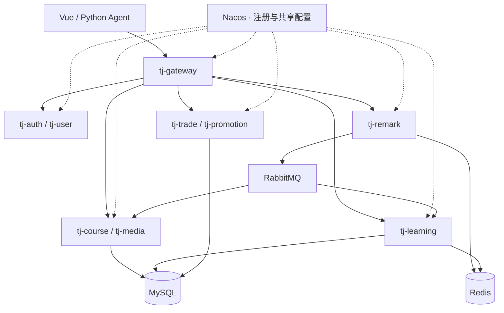
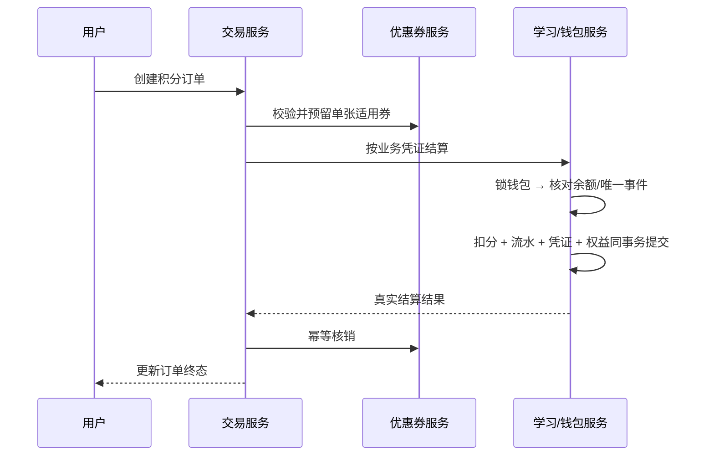

# LearnTrail Backend

**支撑内容创作、积分交易与连续学习的 Java 微服务后端。**

Java11、Spring Boot2.7、Spring Cloud2021、Spring Cloud Alibaba、MyBatis-Plus、MySQL、Redis、RabbitMQ、Nacos、OpenFeign，共同承载平台业务与 AI 助手使用的业务 API。

[平台总览](../README.md) · [AI 助手](../learntrail-agent/README.md) · [快速开始](quickstart.md)

## 服务划分



| 领域 | 模块 | 主要职责 |
| --- | --- | --- |
| 统一入口 | `tj-gateway` | 服务路由、JWT 鉴权、请求身份传递 |
| 身份与用户 | `tj-auth`、`tj-user` | 登录与刷新、角色、账号状态、个人资料 |
| 内容与媒资 | `tj-course`、`tj-media` | 创作者、专栏、草稿与发布、目录、上传与播放授权 |
| 学习 | `tj-learning` | 文章、课表、小节进度、问答、有效学习与积分钱包 |
| 交易 | `tj-trade`、`tj-promotion` | 积分订单、计价、单券预留／核销、结算恢复 |
| 互动 | `tj-remark` | 点赞关系、浏览／播放去重、版本化聚合 |
| 检索与支撑 | `tj-search`、`tj-message`、`tj-data`、`tj-exam`、`tj-pay` | 搜索、通知、统计、练习与渠道适配 |
| 基础组件 | `tj-common`、`tj-api` | 通用组件、Feign Client、DTO 与服务契约 |

目录、包名和服务注册名保持稳定，平台通过展示名称、产品领域和统一入口组织业务。

## 统一认证与业务权限

认证服务签发访问令牌和刷新令牌；网关与服务端资源组件校验身份，通过 `UserContext` 关联业务用户。刷新时复核账号状态。创作接口核对内容归属，运营接口验证员工身份，播放接口结合内容状态、试看和学习权益授权。

Python Agent 使用同一套 RSA 公钥与 JWT，并通过 Java 用户接口复核账号状态；文章和学习工具继续调用业务接口执行资源权限检查。

入口：[网关](../tj-gateway/src/main/java/com/tianji/gateway/) · [认证](../tj-auth/tj-auth-service/src/main/java/com/tianji/auth/) · [资源 SDK](../tj-auth/tj-auth-resource-sdk/)

## 内容生命周期

视频专栏复用课程草稿、发布与目录能力。创作者编辑基础信息、媒资和分集后发布；修订阶段保留最后发布内容，未更换的视频尽量保留小节 ID 和观看进度。专栏下架停止新增解锁，已有学习权益保留；运营屏蔽独立控制新的播放授权与讨论。

文章支持纯文本／Markdown、来源链接和作者信息，具备创建、编辑、发布、归档与运营管理。Markdown 前端禁用原始 HTML，并使用 DOMPurify 净化渲染结果。文章与专栏通过显式关联组织知识路径。

入口：[StudioService](../tj-course/src/main/java/com/tianji/course/service/StudioService.java) · [StudioArticleService](../tj-learning/src/main/java/com/tianji/learning/service/StudioArticleService.java) · [媒体服务](../tj-media/src/main/java/com/tianji/media/service/impl/MediaServiceImpl.java)

## 积分交易与幂等



账户初始1000分，站内首次有效阅读默认20分，学习活动时长、每日上限与唯一事件由规则表维护。钱包与原签到积分榜分离。

本地事务保证钱包、流水、结算凭证和学习权益一致；订单与券的跨服务状态通过幂等接口、真实凭证查询和恢复任务推进。取消处理中订单先检查实际结算结果，避免已扣分订单被错误取消。

入口：[积分结算](../tj-learning/src/main/java/com/tianji/learning/service/PointsSettlementService.java) · [有效学习](../tj-learning/src/main/java/com/tianji/learning/service/LearningActivityService.java) · [积分订单](../tj-trade/src/main/java/com/tianji/trade/service/PointsOrderService.java) · [积分券](../tj-promotion/src/main/java/com/tianji/promotion/service/PointsCouponService.java)

## 学习进度缓存与异步落库

播放器根据已签发授权请求视频，按当前用户有效课表和小节提交进度。学习服务复核课程／小节关系，利用缓存合并高频更新，由延迟任务回写学习记录；续播从课程权益和正式小节读取进度。

缓存键与记录对象共同携带课表及小节标识，更新保持进度语义和归属一致。前端页面离开、暂停与结束时补充保存，避免只依赖定时更新。

入口：[LearningRecordServiceImpl](../tj-learning/src/main/java/com/tianji/learning/service/impl/LearningRecordServiceImpl.java) · [延迟处理](../tj-learning/src/main/java/com/tianji/learning/utils/LearningRecordDelayTaskHandler.java)

## 点赞与内容热度

1. 文章／专栏操作先核对用户和公开内容；业务类型参与 Redis key，隔离不同内容 ID。
2. Lua 原子执行点赞／取消、累计量更新、版本递增与待同步登记；浏览／播放按服务端日期对账号去重。
3. 定时任务发送资源统计快照，发送阶段保留待同步记录。
4. 文章／专栏消费者只接受更高版本，更新 MySQL 计数后发送确认。
5. 确认版本与 Redis 当前版本相同才移除标记；失败重试、重复投递和乱序消息均遵循同一版本契约。

公开列表从 MySQL 返回统计，排序在分页前执行；计数同步显式保留内容更新时间。

入口：[Redis 实现](../tj-remark/src/main/java/com/tianji/remark/service/impl/LikedRecordServiceRedisImpl.java) · [Outbox](../tj-remark/src/main/java/com/tianji/remark/task/ContentStatsOutbox.java) · [文章消费](../tj-learning/src/main/java/com/tianji/learning/mq/ArticleStatsListener.java) · [专栏消费](../tj-course/src/main/java/com/tianji/course/mq/SeriesStatsListener.java)

## 数据与服务契约

- MySQL 保存内容、订单、权益和业务凭证；Redis 承担短周期状态与高频互动。
- RabbitMQ 传递异步事件；业务消费者维护幂等或资源版本条件。
- Feign Client 与跨服务 DTO 集中在 `tj-api`，接口变更与调用方在同一仓库维护。
- 业务迁移位于 [database/migrations](../database/migrations/)，逐次扩展领域结构。
- AI PostgreSQL 独立保存会话、知识索引与工作流状态，业务事实通过 Java API 获取。

## 测试与运行

发布验证覆盖141项离线业务测试，包括账号、权限、课程生命周期、文章、学习记录、积分交易、优惠券和内容计数。真实接口验证覆盖并发幂等、匿名／越权、MQ同步、全局排序、视频Range读取及域名登录。

```bash
# 使用 JDK 11，从仓库根目录执行
mvn -DskipTests test-compile
python3 scripts/run_local.py
```

环境变量、数据库准备、服务端口和域名代理见[快速开始](quickstart.md)。
