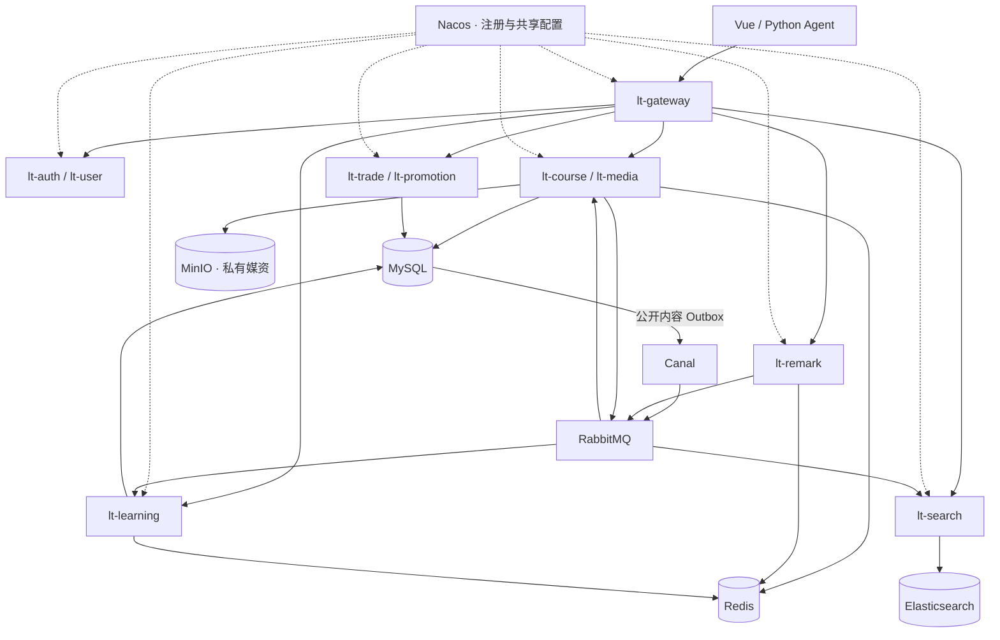
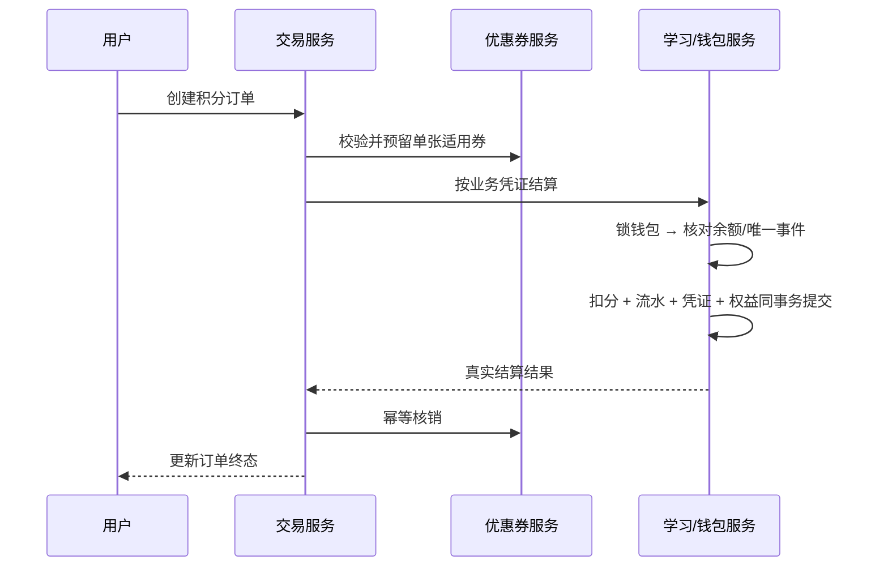

# LearnTrail Backend

**支撑内容创作、积分交易与连续学习的 Java 微服务后端。**

Java 11、Spring Boot 2.7、Spring Cloud 2021、Spring Cloud Alibaba、MyBatis-Plus 和 OpenFeign 承载平台业务与 AI 助手使用的 API。MySQL、Redis、RabbitMQ 和 Nacos 提供业务基础设施，分片上传与全文搜索分别接入 MinIO 和 Elasticsearch／IK。

[平台总览](../README.md) · [AI 助手](../learntrail-agent/README.md) · [快速开始](quickstart.md)

## 服务划分



| 领域 | 模块 | 主要职责 |
| --- | --- | --- |
| 统一入口 | `lt-gateway` | 服务路由、JWT 鉴权、请求身份传递 |
| 身份与用户 | `lt-auth`、`lt-user` | 登录与刷新、角色、账号状态、个人资料 |
| 内容与媒资 | `lt-course`、`lt-media` | 创作者、专栏、草稿与发布、分片续传、媒体处理与播放授权 |
| 学习 | `lt-learning` | 文章、课表、小节进度、问答、有效学习与积分钱包 |
| 交易 | `lt-trade`、`lt-promotion` | 积分订单、计价、单券预留／核销、结算恢复 |
| 互动 | `lt-remark` | 点赞关系、浏览／播放去重、版本化聚合 |
| 搜索 | `lt-search` | 站内文章和专栏全文搜索、公开索引更新与回放 |
| 支撑服务 | `lt-message`、`lt-data`、`lt-exam`、`lt-pay` | 通知、统计、练习与渠道适配 |
| 基础组件 | `lt-common`、`lt-api` | 通用组件、Feign Client、DTO 与服务契约 |

模块目录与 Maven artifactId 统一采用 `lt-*`，Java groupId 和包根为 `com.learntrail`，父工程为 `lt-parent`。业务服务在 Nacos 中注册为 `lt-auth`、`lt-user`、`lt-course` 等名称；网关路由、Feign Client 与认证公钥发现使用相同服务名。认证可执行模块为 `lt-auth/lt-auth-service`，其注册名为 `lt-auth`。

HTTP 接口与业务数据结构保持兼容。消息转换器兼容升级前的 Java 类型头，持久化失败队列由独立配置指定，服务发现改名与消息队列生命周期分别管理。

## 统一认证与业务权限

认证服务签发访问令牌和刷新令牌；网关与服务端资源组件校验身份，通过 `UserContext` 关联业务用户。刷新时复核账号状态。创作接口核对内容归属，运营接口验证员工身份，播放接口结合内容状态、试看和学习权益授权。

Python Agent 使用同一套 RSA 公钥与 JWT，并通过 Java 用户接口复核账号状态。下表中的路径为 Java 网关路径，浏览器经同源 `/api` 访问。

| Java API | Agent 使用方式 |
| --- | --- |
| `GET /ls/studio-articles/access` | Java 根据当前用户是否为员工返回 `operator`。运营模式、协作、自动分派至运营，以及任务恢复或轨迹读取由 Python 据此校验 |
| `GET /ls/studio-articles/published`、`/published/{slug}`、`/published/links` | 查询已发布文章和正文，并核对候选文章的当前公开状态 |
| `GET /ss/content-search` | 在默认排序的文章查找中补查全文，候选结果继续由文章服务复核 |
| `GET /ls/lessons/page`、`/ls/learning-records/course/{courseId}` | 查询当前用户的课表和具备权益的课程进度 |

入口：[网关](../lt-gateway/src/main/java/com/learntrail/gateway/) · [认证](../lt-auth/lt-auth-service/src/main/java/com/learntrail/auth/) · [资源 SDK](../lt-auth/lt-auth-resource-sdk/)

## 内容生命周期

视频专栏复用课程草稿、发布与目录能力。创作者编辑基础信息、媒资和分集后发布；修订阶段保留最后发布内容，未更换的视频尽量保留小节 ID 和观看进度。专栏下架停止新增解锁，已有学习权益保留；运营屏蔽独立控制新的播放授权与讨论。

文章支持纯文本／Markdown、来源链接和作者信息，具备创建、编辑、发布、归档与运营管理。Markdown 前端禁用原始 HTML，并使用 DOMPurify 净化渲染结果。文章与专栏通过显式关联组织知识路径。

入口：[StudioService](../lt-course/src/main/java/com/learntrail/course/service/StudioService.java) · [StudioArticleService](../lt-learning/src/main/java/com/learntrail/learning/service/StudioArticleService.java) · [媒体服务](../lt-media/src/main/java/com/learntrail/media/service/impl/MediaServiceImpl.java)

### 分片上传与可恢复媒体任务

启用分片上传后，`lt-media` 在 `/ms/medias/studio/uploads` 建立归属于创作者的上传会话。浏览器凭短期签名直传 MinIO 私有桶。查询上传状态会对账并补记已完成的分片回执，断线后只补剩余分片。合并前校验分片编号、长度和 ETag，后续任务校验完整文件的 SHA-256。

RabbitMQ 投递媒体处理任务，Worker 通过租约领取并异步生成正式视频、封面和试看文件。过期租约可重新领取，输出提交需匹配当前领取令牌。媒资进入 `READY` 后才能绑定发布并获取相应播放授权。

源码入口见 [上传 API](../lt-media/src/main/java/com/learntrail/media/controller/MediaUploadController.java)、[上传服务](../lt-media/src/main/java/com/learntrail/media/service/MediaUploadService.java)、[处理 Worker](../lt-media/src/main/java/com/learntrail/media/service/MediaTaskWorker.java) 和 [启用步骤](quickstart.md#启用分片上传缓存和全文检索)。

### 公开内容缓存与全文索引

- **公开内容缓存**。文章和专栏读取公开版本号后访问 Redis。短期空值缓存、随机 TTL 与 Redisson 锁降低热点回源，业务更新提交后清理旧缓存。个人学习进度、权益和访问判定仍在业务服务处理。
- **全文索引**。文章和专栏的公开投影与 Outbox 在业务事务内写入，Canal 订阅 Outbox 并经 RabbitMQ 投递，由 `lt-search` 以外部版本写入 Elasticsearch。归档或下架后索引保留不可见版本，迟到的旧事件无法恢复旧内容。索引重建可回放当前公开投影。

源码入口见 [Redis 缓存](../lt-common/src/main/java/com/learntrail/common/autoconfigure/redisson/PublicContentCache.java)、[索引消费者](../lt-search/src/main/java/com/learntrail/search/mq/PublicContentConsumer.java)、[全文索引](../lt-search/src/main/java/com/learntrail/search/service/PublicContentIndex.java) 和 [回放 SQL](../database/replay_public_search.sql)。

## 积分交易与幂等



账户初始1000分，站内首次有效阅读默认20分，学习活动时长、每日上限与唯一事件由规则表维护。钱包与原签到积分榜分离。

本地事务保证钱包、流水、结算凭证和学习权益一致；订单与券的跨服务状态通过幂等接口、真实凭证查询和恢复任务推进。取消处理中订单先检查实际结算结果，避免已扣分订单被错误取消。

恢复任务按租约领取 `PAYING` 或 `CANCELLING` 阶段的订单，并按钱包凭证继续处理。自动恢复失败会退避并记录错误，达到 8 次后保留原处理阶段供核查。

入口见 [积分结算](../lt-learning/src/main/java/com/learntrail/learning/service/PointsSettlementService.java)、[有效学习](../lt-learning/src/main/java/com/learntrail/learning/service/LearningActivityService.java)、[积分订单](../lt-trade/src/main/java/com/learntrail/trade/service/PointsOrderService.java)、[恢复任务](../lt-trade/src/main/java/com/learntrail/trade/service/PointsOrderRecovery.java) 和 [积分券](../lt-promotion/src/main/java/com/learntrail/promotion/service/PointsCouponService.java)。

## 学习进度缓存与异步落库

播放器根据已签发授权请求视频，按当前用户有效课表和小节提交进度。学习服务复核课程／小节关系，利用缓存合并高频更新，由延迟任务回写学习记录；续播从课程权益和正式小节读取进度。

缓存键与记录对象共同携带课表及小节标识，更新保持进度语义和归属一致。前端页面离开、暂停与结束时补充保存，避免只依赖定时更新。

入口：[LearningRecordServiceImpl](../lt-learning/src/main/java/com/learntrail/learning/service/impl/LearningRecordServiceImpl.java) · [延迟处理](../lt-learning/src/main/java/com/learntrail/learning/utils/LearningRecordDelayTaskHandler.java)

## 点赞与内容热度

1. 文章／专栏操作先核对用户和公开内容；业务类型参与 Redis key，隔离不同内容 ID。
2. Lua 原子执行点赞／取消、累计量更新、版本递增与待同步登记；浏览／播放按服务端日期对账号去重。
3. 定时任务发送资源统计快照，发送阶段保留待同步记录。
4. 文章／专栏消费者只接受更高版本，更新 MySQL 计数后发送确认。
5. 确认版本与 Redis 当前版本相同才移除标记；失败重试、重复投递和乱序消息均遵循同一版本契约。

公开列表从 MySQL 返回统计，排序在分页前执行；计数同步显式保留内容更新时间。

入口：[Redis 实现](../lt-remark/src/main/java/com/learntrail/remark/service/impl/LikedRecordServiceRedisImpl.java) · [Outbox](../lt-remark/src/main/java/com/learntrail/remark/task/ContentStatsOutbox.java) · [文章消费](../lt-learning/src/main/java/com/learntrail/learning/mq/ArticleStatsListener.java) · [专栏消费](../lt-course/src/main/java/com/learntrail/course/mq/SeriesStatsListener.java)

## 数据与服务契约

- MySQL 保存内容、订单、权益和业务凭证；Redis 承担短周期状态与高频互动。
- RabbitMQ 传递异步事件；业务消费者维护幂等或资源版本条件。
- Feign Client 与跨服务 DTO 集中在 `lt-api`，接口变更与调用方在同一仓库维护。
- 业务迁移位于 [database/migrations](../database/migrations/)，逐次扩展领域结构。
- AI PostgreSQL 独立保存会话、知识索引与工作流状态，业务事实通过 Java API 获取。

## 测试与运行

离线业务测试覆盖账号、权限、内容生命周期、媒体任务、积分结算和内容计数。分片续传、对象侧回执对账、过期任务恢复、公开索引回放和视频 Range 读取已在独立联调环境验证。

```bash
# 使用 JDK 11，从仓库根目录执行
mvn -DskipTests test-compile
python3 scripts/run_local.py
```

环境变量、数据库准备、服务端口和域名代理见[快速开始](quickstart.md)。
