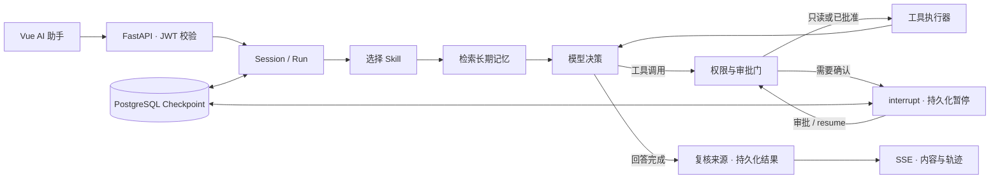

# LearnTrail AI

**融入真实学习业务的可恢复 Agent 系统。**

LearnTrail AI 是平台的独立 Python 服务。它复用 Java 身份认证，通过业务 API 获取公开文章和个人学习进度，把知识检索、工具调用、Skills、Memory 与人工确认组织为可追踪、可恢复的任务流程。

[平台总览](../README.md) · [工作流架构](../docs/agent-architecture.md) · [Java 后端](../docs/backend-architecture.md) · [运行配置](../docs/quickstart.md)

## 技术栈

| 层次 | 技术与职责 |
| --- | --- |
| API | Python 3.12、FastAPI、Pydantic 2、HTTPX、SSE |
| 编排 | LangGraph StateGraph、原生 Function Calling、工具 Registry／Executor |
| 检索 | PostgreSQL、pgvector、BM25、RRF、可替换 Reranker Client |
| 状态 | Psycopg 连接池、会话／Run、加密 Checkpoint、审批及长期记忆 |
| 协议 | MCP Client／Server、stdio、Streamable HTTP |
| 观测 | Langfuse、OpenTelemetry、Usage 与耗时统计 |
| 工程 | uv／锁文件、pytest、真实隔离数据库测试、分阶段评测 CLI |

## 从请求到任务完成



### RAG：双路检索与引用回答

1. 通过 Java API 读取当前可访问文章，清洗正文、按标题和长度分块，计算正文与索引配置指纹。
2. 使用独立 Embedding Client 生成向量，将文章、Chunk、位置及内容哈希写入 pgvector；重复内容跳过，更新切换索引版本。
3. 向量检索与 BM25 独立召回，RRF 融合排名；Reranker 通过统一 Client 接口接入。
4. 回答绑定原文片段、位置与哈希，生成结束复核来源，返回可点击引用。

源码：[索引](src/learntrail_agent/rag/indexer.py) · [检索](src/learntrail_agent/rag/retriever.py) · [BM25](src/learntrail_agent/rag/bm25.py) · [回答](src/learntrail_agent/rag/qa.py) · [精排接口](src/learntrail_agent/clients/reranker.py)

### Agent：模型决策与受控执行

原生 Function Calling 提供工具 Schema，Registry 维护工具与权限，Executor 统一参数校验、超时、并发和输出预算。工具调用、结果回传和模型 Usage 都归入服务器 Run。

| 业务工具 | 数据来源 |
| --- | --- |
| `search_knowledge_base` | 对当前用户授权文章执行检索，返回原文片段与引用依据 |
| `search_articles` | Java 已发布文章关键词与分页接口 |
| `get_learning_progress` | 当前用户真实课表和课程进度 |

源码：[工具注册与执行](src/learntrail_agent/agent/tools.py) · [业务工具](src/learntrail_agent/agent/learntrail_tools.py) · [Java 客户端](src/learntrail_agent/clients/java.py) · [学习客户端](src/learntrail_agent/clients/learning.py)

### LangGraph：持久化工作流

`select_skill → memory → agent → gate → tools → agent` 构成状态图。模型输出追加为消息，工具结果按调用 ID 回填；Checkpoint 保存图状态，数据库维护 Session／Run 与恢复入口。服务重启后可读取会话和已暂停任务，停止／断开连接会结束生成并记录终态。

源码：[状态图](src/learntrail_agent/agent/loop.py) · [任务服务](src/learntrail_agent/services/agent.py) · [Checkpoint](src/learntrail_agent/storage/checkpoints.py) · [会话存储](src/learntrail_agent/storage/repositories.py)

### MCP、Skills、Memory 与 HITL

| 能力 | 实现 |
| --- | --- |
| MCP | 第一方 Server 复用业务工具与 JWT；Client 支持 stdio／HTTP，通过可信配置和工具白名单接入 |
| Skills | 按 Markdown 元数据发现、选择和加载技能，内容哈希与工具授权共同确定执行范围 |
| 短期记忆 | 按整轮消息截取历史窗口，在字符预算内保留有效上下文 |
| 长期记忆 | 本人记忆 CRUD、来源、版本、过期、去重与冲突检测，任务时有界检索 |
| HITL | 资源快照、审批有效期、批准／拒绝／取消、`interrupt` 暂停和 `Command(resume)` 恢复 |

写操作采用“提出请求 → 审批记录 → 用户决定 → 复核资源 → 执行”的流程，当前覆盖记忆提案与 AI 演示操作。

源码：[MCP Server](src/learntrail_agent/mcp_server.py) · [MCP Client](src/learntrail_agent/clients/mcp.py) · [Skills](src/learntrail_agent/agent/skills.py) · [长期记忆](src/learntrail_agent/storage/memory.py) · [审批](src/learntrail_agent/storage/approvals.py)

### 可观测性

HTTP、SSE、模型、工具、检索、Skills、Memory 和 Checkpoint 通过 Trace 串联。Langfuse 接收 Trace／Generation／Usage，OpenTelemetry 提供 Span 和指标；评测报告结合工具轨迹、时延、Token、Usage 完整性与配置价格统计任务成本。

源码：[Telemetry](src/learntrail_agent/observability.py) · [模型客户端](src/learntrail_agent/clients/llm.py)

## 评测与实验

v4 数据集包含 **150 条场景**：65 条 RAG 问答与 85 条功能契约场景，覆盖 Agent、Memory、Skills、MCP、HITL；按 Development／Validation／Test 划分为90／30／30。RAG 标准答案绑定94项原文事实，固定语料为7篇业务文章。

| 评测层 | 核查内容 |
| --- | --- |
| 数据校验 | 场景 Schema、划分、相关来源、原文事实与内容哈希 |
| 功能契约 | 工具选择与参数、执行轨迹、记忆隔离、审批与恢复、MCP 传输 |
| 检索 | Recall／MRR／NDCG@K、归档命中、零相关误召回 |
| 生成 | 回答与拒答状态、原文引用、独立 Judge 评分 |
| 运行 | 请求成功、超时、模型／工具次数、Token、时延及成本估算 |

真实检索实验使用 Java 授权正文、1024维 Embedding、隔离 PostgreSQL／pgvector 和生产 Retriever。64条有相关来源问题、K=5 的结果如下：

| 方案 | Recall@5 | MRR@5 | NDCG@5 |
| --- | ---: | ---: | ---: |
| Vector Only | 0.9922 | 0.9120 | 0.9228 |
| BM25 Only | 0.9766 | 0.9060 | 0.9147 |
| Hybrid · RRF | **0.9922** | **0.9458** | **0.9466** |

Hybrid 相比 Vector 的召回持平、MRR 提升0.03385；相比 BM25 的召回提升1.5625个百分点。65题真实 Hybrid 生成与独立 Judge 调用均完成，组合条件通过61题。该轮未启用 Reranker；零相关题独立报告，耗时按各次实验的实际运行条件记录。

源码：[评测 CLI](src/learntrail_agent/evaluation/runner.py) · [指标](src/learntrail_agent/evaluation/metrics.py) · [Judge](src/learntrail_agent/evaluation/judge.py) · [v4 数据](evaluation/dataset-v4.json) · [案例](evaluation/cases-v4.jsonl)

```bash
# 校验数据，不调用模型
uv run --locked python -m learntrail_agent.evaluation.runner --mode validate --split all

# 确定性场景执行：使用隔离 PostgreSQL 和受控模型
uv run --locked --group evaluation python -m learntrail_agent.evaluation.runner --mode deterministic --split all

# 按需运行真实模型实验，明确限制预算
uv run --locked --group evaluation python -m learntrail_agent.evaluation.runner \
  --mode live --live --categories rag --case-ids rag-001 \
  --schemes vector bm25 hybrid --max-model-calls 3
```

## 配置与启动

1. 准备 Python3.12、uv、PostgreSQL 与 pgvector，启动 Java 网关。
2. `uv sync --locked`；从[配置模板](.env.example)复制 `.env`，分别设置模型、Embedding、数据库和 Java 公钥。
3. 备份数据库后按顺序应用[migrations](migrations/)下 V001–V006；保留加密 Checkpoint 使用的密钥。
4. 选择运行入口：

```bash
# 本机开发，监听127.0.0.1:8100
uv run --locked python -m learntrail_agent

# 域名部署，开放受认证业务入口
uv run --locked uvicorn learntrail_agent.deployment:app --host 0.0.0.0 --port 8100 --no-access-log
```

主站 `www.learntrail.com` 通过 `/ai/v1/sessions`、`/ai/v1/skills`、`/ai/v1/memories` 访问。完整启动与代理配置见[快速开始](../docs/quickstart.md)。

## 测试

```bash
uv run --locked --group evaluation pytest -q
```

真实数据库测试通过私有 `LEARNTRAIL_TEST_DATABASE_URL` 启用，每个测试创建并清理独立 Schema。发布验证执行了654项包含隔离数据库的回归及12项部署入口测试；另有一项真实 Java 文章创建用例通过独立测试账号按需运行。域名端已验证真实 Agent SSE、身份隔离及进程重启后的会话恢复。

## 下一步

以现有评测为依据继续优化 Reranker、无答案判断与业务工具覆盖，并将可恢复工作流扩展到更完整的学习规划和创作者辅助场景。
