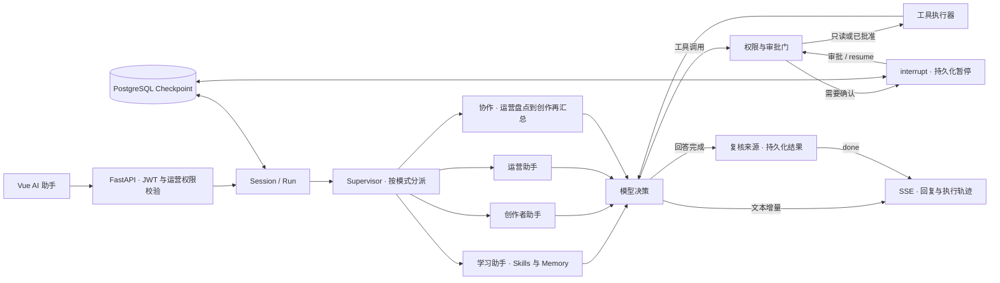

# LearnTrail AI

**融入真实学习业务的可恢复 Agent 系统。**

LearnTrail AI 是平台的独立 Python 服务，提供学习、创作者和运营助手。它复用 Java 身份认证，通过业务 API 获取公开文章和个人学习进度。LangGraph 负责分派任务、调用工具并保存工作流状态。

[平台总览](../README.md) · [工作流架构](../docs/agent-architecture.md) · [Java 后端](../docs/backend-architecture.md) · [运行配置](../docs/quickstart.md)

## 技术栈

| 层次 | 技术与职责 |
| --- | --- |
| API | Python 3.12、FastAPI、Pydantic 2、HTTPX、SSE |
| 编排 | LangGraph StateGraph、Supervisor 分派、原生 Function Calling、工具 Registry／Executor |
| 检索 | PostgreSQL、pgvector、BM25、RRF、可替换 Reranker Client |
| 状态 | Psycopg 连接池、会话／Run、加密 Checkpoint、审批及长期记忆 |
| 协议 | MCP Client／Server、stdio、Streamable HTTP |
| 观测 | Langfuse、OpenTelemetry、Usage 与耗时统计 |
| 工程 | uv／锁文件、pytest、真实隔离数据库测试、分阶段评测 CLI |

## 从请求到任务完成



### RAG：双路检索与引用回答

1. 通过 Java API 读取当前可访问文章，清洗正文、按标题和长度分块，计算正文与索引配置指纹。
2. 使用独立 Embedding Client 生成向量，将文章、Chunk、位置及内容哈希写入 pgvector；重复内容跳过，更新切换索引版本。
3. 向量检索与 BM25 独立召回，RRF 融合排名；Reranker 通过统一 Client 接口接入。
4. 回答绑定原文片段、位置与哈希，生成结束复核来源，返回可点击引用。

源码：[索引](src/learntrail_agent/rag/indexer.py) · [检索](src/learntrail_agent/rag/retriever.py) · [BM25](src/learntrail_agent/rag/bm25.py) · [回答](src/learntrail_agent/rag/qa.py) · [精排接口](src/learntrail_agent/clients/reranker.py)

### Agent：助手分派与工具执行

在 Vue 对话框选择助手。直接调用 API 时，在 `POST /v1/sessions/{session_id}/agent` 或流式接口 `POST /v1/sessions/{session_id}/agent/stream` 的请求体中传入 `assistant`。

| 模式 | 请求值 | 能力 |
| --- | --- | --- |
| 学习助手 | `learning`（默认） | 文章带引用问答、个人学习进度、学习 Skills 与记忆 |
| 创作者助手 | `creator` | 根据用户提供的素材润色、拟文章大纲、规划视频专栏，可查询公开文章 |
| 运营助手 | `operations` | 盘点已发布文章，按公开阅读量或点赞量排序，提供选题和内容风险复核建议 |
| 自动分派 | `auto` | 根据问题中的意图关键词选择相应助手。问题同时涉及运营和创作时走协作流程 |
| 创作与运营协作 | `collaborate` | 同一 Run 先由运营盘点，再由创作者拟稿，最后汇总并流式输出一条回答 |

运营与协作模式仅向运营人员展示。Python 调用 Java 的 `GET /ls/studio-articles/access` 核验身份，直接请求、自动分派至运营、恢复任务和读取轨迹都需通过服务端校验。创作者和运营助手使用公开文章的只读工具。

原生 Function Calling 提供工具 Schema，Registry 维护工具与权限，Executor 统一参数校验、超时、并发和输出预算。工具调用、结果回传和模型 Usage 都归入服务器 Run。

| 业务工具 | 数据来源 |
| --- | --- |
| `search_knowledge_base` | 对当前用户授权文章执行检索，返回原文片段与引用依据 |
| `search_articles` | Java 已发布文章目录，支持关键词、分页、阅读量或点赞量排序。默认排序且标题摘要零匹配时补查站内全文 |
| `get_learning_progress` | 当前用户真实课表和课程进度 |

全文搜索返回候选文章，正文仍经 Java 接口复核。公开目录确认文章存在且正文接口明确拒绝访问时，工具返回当前页已确认受限的数量。助手可据此区分检索无命中、知识库缺少可引用片段、账号无权阅读。

源码入口见 [助手分派](src/learntrail_agent/agent/assistants.py)、[工具注册与执行](src/learntrail_agent/agent/tools.py)、[业务工具](src/learntrail_agent/agent/learntrail_tools.py) 和 [Java 客户端](src/learntrail_agent/clients/java.py)。

### LangGraph：持久化工作流

`supervisor` 确定当前 Run 的助手，学习模式执行 Skill 选择和长期记忆检索。模型和工具之间复用同一个执行循环，协作模式通过 `handoff` 传递结果，最后由 `synthesis` 汇总。Checkpoint 保存图状态，服务重启后可读回会话和已暂停任务。

每条 Agent SSE 流可暂存 256 个事件。队列满时等待发送端腾出空间，随后继续输出。取消或断连时结束生成并清理该轮任务，完整回复保存后才发送 `done`。

源码：[状态图](src/learntrail_agent/agent/loop.py) · [任务服务](src/learntrail_agent/services/agent.py) · [Checkpoint](src/learntrail_agent/storage/checkpoints.py) · [会话存储](src/learntrail_agent/storage/repositories.py)

### MCP、Skills、Memory 与 HITL

| 能力 | 实现 |
| --- | --- |
| MCP | 第一方 Server 复用业务工具与 JWT；Client 支持 stdio／HTTP，通过可信配置和工具白名单接入 |
| Skills | 按 Markdown 元数据发现、选择和加载技能，内容哈希与工具授权共同确定执行范围 |
| 短期记忆 | 按整轮消息截取历史窗口，在字符预算内保留有效上下文 |
| 长期记忆 | 本人记忆 CRUD、来源、版本、过期、去重与冲突检测，任务时有界检索 |
| HITL | 资源快照、审批有效期、批准／拒绝／取消、`interrupt` 暂停和 `Command(resume)` 恢复 |

写操作采用“提出请求 → 审批记录 → 用户决定 → 复核资源 → 执行”的流程，当前覆盖记忆提案与 AI 演示操作。

源码：[MCP Server](src/learntrail_agent/mcp_server.py) · [MCP Client](src/learntrail_agent/clients/mcp.py) · [Skills](src/learntrail_agent/agent/skills.py) · [长期记忆](src/learntrail_agent/storage/memory.py) · [审批](src/learntrail_agent/storage/approvals.py)

### 可观测性

HTTP、SSE、模型、工具、检索、Skills、Memory 和 Checkpoint 通过 Trace 串联。Langfuse 接收 Trace／Generation／Usage，OpenTelemetry 提供 Span 和指标；评测报告结合工具轨迹、时延、Token、Usage 完整性与配置价格统计任务成本。

源码：[Telemetry](src/learntrail_agent/observability.py) · [模型客户端](src/learntrail_agent/clients/llm.py)

## 评测与实验

当前默认数据集为 **v5：150 条检索题、19 篇已发布文章**，Development／Validation／Test 为90／30／30，能力／回归为130／20。保留原65条RAG问题及其相关性标签，并将另外85条整理为文章检索问题；论文资料使用本站导读作为语料。

| 评测层 | 核查内容 |
| --- | --- |
| v5 数据校验 | 题目 Schema、分组划分、相关来源、原文事实与内容哈希 |
| v5 生产检索 | Vector、BM25、Hybrid+RRF，Recall／MRR／NDCG@K及零相关误召回 |
| 功能回归 | pytest 覆盖工具、执行轨迹、记忆隔离、审批恢复、MCP与数据库 |
| 历史评测 | v1–v4保留混合能力案例、回答／拒答、引用与独立Judge实验入口 |

真实检索实验使用 Java 授权正文、1024维 Embedding、隔离 PostgreSQL／pgvector 和生产 Retriever。三个方案共享同一次索引，每个方案执行150题，共450次搜索。Recall／MRR／NDCG按142条有相关来源的问题计算，另外8条零相关问题单列；K=5按Chunk排名计数，同文章重复Chunk不增加文档召回。

| 方案 | Recall@5 | MRR@5 | NDCG@5 | 零相关误召回 |
| --- | ---: | ---: | ---: | ---: |
| Vector Only | 0.9718 | 0.9034 | 0.9131 | 1/8 |
| BM25 Only | 0.9683 | 0.9281 | 0.9330 | 8/8 |
| Hybrid · RRF | **0.9965** | **0.9486** | **0.9544** | 8/8 |

本轮Hybrid的召回和排名指标最高；Vector、BM25、Hybrid的检索条件通过数分别为144／150、137／150、141／150，包含零相关问题的判定。BM25分支带来的零相关误召回作为后续优化依据。v5聚焦检索，生成与Judge调用均为0，Reranker未启用；实验参数和结果见[v5实验记录](evaluation/results/v5-retrieval-summary.md)。

源码：[评测 CLI](src/learntrail_agent/evaluation/runner.py) · [指标](src/learntrail_agent/evaluation/metrics.py) · [v5 数据](evaluation/dataset-v5.json) · [案例](evaluation/cases-v5.jsonl) · [语料](evaluation/corpus-v5.json) · [历史 v4](evaluation/dataset-v4.json)

```bash
# 校验数据，不调用模型
uv run --locked python -m learntrail_agent.evaluation.runner --mode validate --split all

# v5离线数据与文章快照BM25检查
uv run --locked --group evaluation python -m learntrail_agent.evaluation.runner --mode deterministic --split all

# v5生产检索：私下配置LEARNTRAIL_EVAL_TOKEN；调用真实Embedding
uv run --locked --group evaluation python -m learntrail_agent.evaluation.runner \
  --mode live --live --split all --schemes vector bm25 hybrid

# 显式选择历史版本
uv run --locked python -m learntrail_agent.evaluation.runner \
  --dataset evaluation/dataset-v4.json --mode validate --split all
```

## 配置与启动

1. 准备 Python3.12、uv、PostgreSQL 与 pgvector，启动 Java 网关。
2. `uv sync --locked`；从[配置模板](.env.example)复制 `.env`，分别设置模型、Embedding、数据库和 Java 公钥。
3. 备份数据库后按顺序应用[migrations](migrations/)下 V001–V006；保留加密 Checkpoint 使用的密钥。
4. 选择运行入口：

```bash
# 本机开发，监听127.0.0.1:8100
uv run --locked python -m learntrail_agent

# 域名部署，开放受认证业务入口
uv run --locked uvicorn learntrail_agent.deployment:app --host 0.0.0.0 --port 8100 --no-access-log
```

主站 `www.learntrail.com` 通过 `/ai/v1/sessions`、`/ai/v1/skills`、`/ai/v1/memories` 访问。完整启动与代理配置见[快速开始](../docs/quickstart.md)。

## 测试

```bash
uv run --locked --group evaluation pytest -q -k 'not test_live_java_article_lifecycle_with_synthetic_embeddings'
```

通过私有 `LEARNTRAIL_TEST_DATABASE_URL` 启用 PostgreSQL 测试，每个测试在隔离 Schema 中运行。GitHub Actions 运行 Agent 回归与默认 v5 数据校验。上面的命令沿用 CI 的测试范围，真实 Java 文章创建用例通过独立测试账号按需运行。

## 下一步

以现有评测为依据继续优化 Reranker、无答案判断与业务工具覆盖，并将可恢复工作流扩展到更完整的学习规划和创作者辅助场景。
